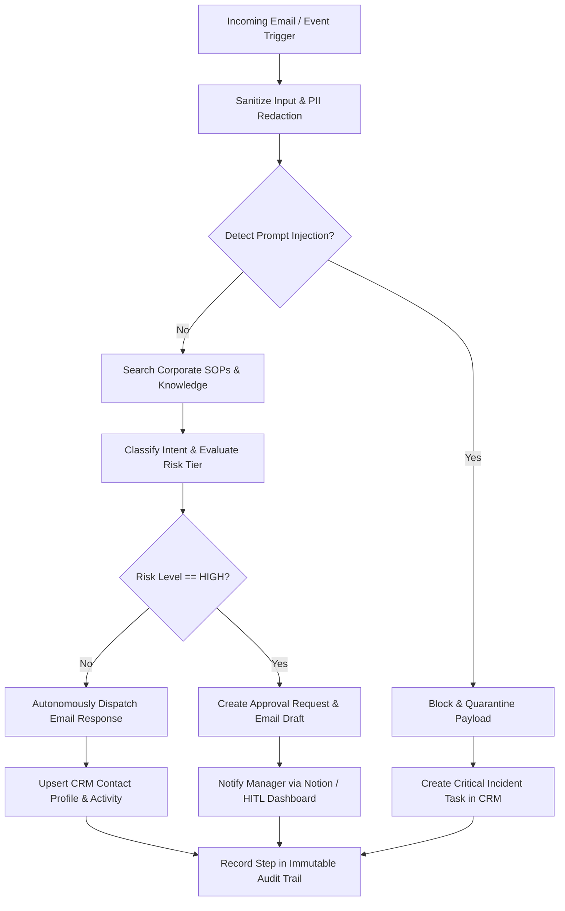

# 🔄 Enterprise AI Employee Operational Workflows

This document outlines the operational pipelines and state transitions implemented in **🧑💼 AI Employee / Business Automation**.

---

## 1. Incoming Communication Pipeline

---

## 2. Human-in-the-Loop (HITL) Sign-Off Workflow

1. **Trigger**: An incoming email requests custom enterprise pricing or contract commitments.
2. **Action Paused**: The AI Employee prepares the response and places it in drafts.
3. **Approval Card Created**: An `ApprovalRequest` record is generated with a unique ID (`APPR-XXXXXX`).
4. **Manager Review**: The supervisor navigates to the HITL portal (`/api/v1/approvals`) or checks Notion tasks.
5. **Decision**:
   - **Approved**: The system dispatches the drafted communication to the customer immediately.
   - **Rejected**: The proposed action is canceled with reviewer feedback recorded for training.

---

## 3. End-of-Day Executive Operational Digest

* **Schedule**: Automated daily trigger at 18:00 (via Celery / Scheduler).
* **Metrics Calculated**:
  - Total communications processed.
  - Autonomous resolution percentage.
  - High-priority tasks registered.
  - Outstanding managerial approvals pending.
* **Delivery**: Published directly to Notion Executive Database and distributed via daily summary report.
